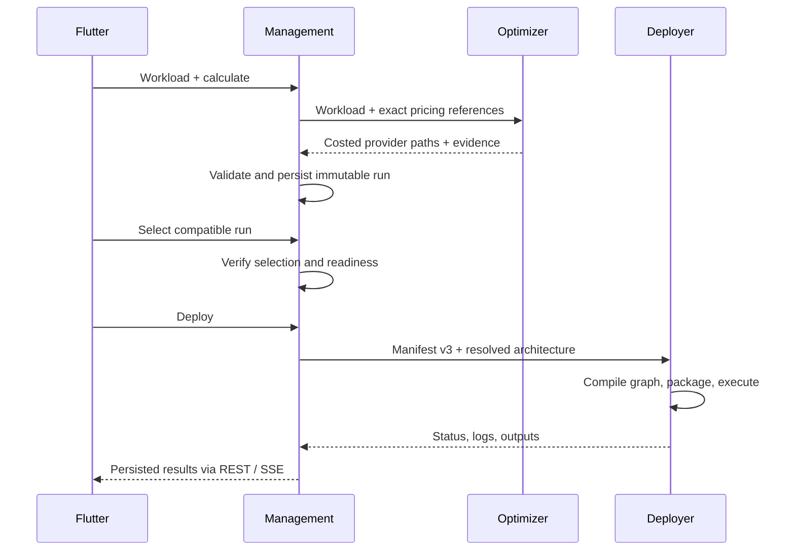

# End-to-End Flows

## From workload to infrastructure

The Optimizer compares complete paths including connection costs. With profile
resolution enabled, the saved run includes a frozen architecture. The Deployer
executes Terraform and provider SDK work from the validated operation package.

Profile resolution defaults to off. The sequence above describes the
implemented deployment contract, not a guarantee that a fresh local startup
can complete a cloud deployment. See [Results and Limits](../runtime/known-limitations.md).

## Detailed flows

| Flow | What the reference explains |
|---|---|
| [Pricing and optimization](../contracts-and-data-flow/pricing-optimization.md) | source acquisition, review, complete-path selection and cost evidence |
| [Credentials and trust](../contracts-and-data-flow/credentials-and-trust.md) | external bootstrap, encrypted Cloud Connections and operation-local secrets |
| [Deployment lifecycle](../contracts-and-data-flow/deployment-lifecycle.md) | immutable run → Manifest v3 → graph → packages/Terraform → outputs |
| [State ownership](../contracts-and-data-flow/state-ownership.md) | durable records, selections and failure behavior |
| [Current cloud graph](current-deployment-graph.md) | actual provider data paths and known divergences |
| [Azure Twin updates](../components/deployer.md) | Persister → ADT Pusher delivery, ownership and retry behavior |

## Offline demo

Demo mode substitutes in-memory API/log adapters behind the same Flutter
screens. It performs no HTTP or provider operations and resets on restart.
Use the [PoC Walkthrough](../user-guide/multi-cloud-walkthrough.md) to inspect it.
