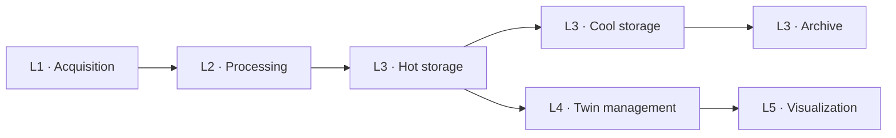
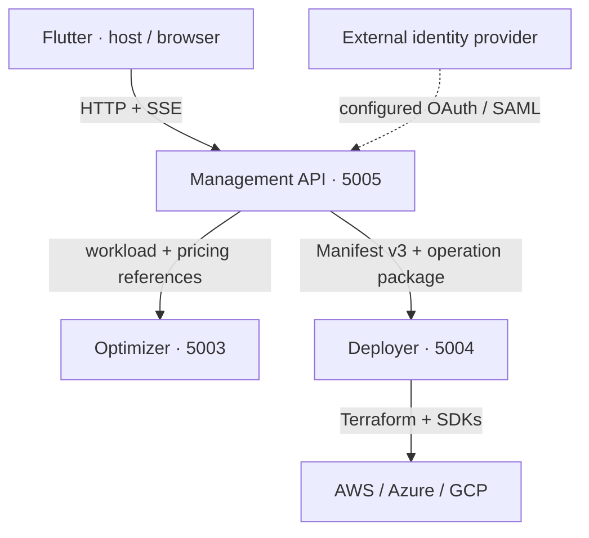

# System Context

Twin2MultiCloud implements a bounded Digital Twin model derived from the
[EDTConf'25 paper](../references/EDT_25__CloudDT_engineering.pdf).

## Logical model

Five responsibilities become seven optimization slots because storage has
three tiers. This is the logical model; the
[current deployment graph](current-deployment-graph.md) records the actual
runtime paths, including Grafana's L3-reader divergence.

## Application boundary

Flutter calls only Management. All three backend ports are published locally
for development; internal service calls use Compose DNS names.

| Owner | Durable state |
|---|---|
| Management API | SQLite users, twins, Cloud Connections, runs and operation history |
| Optimizer | immutable regional pricing catalogs in a named volume; versioned registry/baselines in Git |
| Deployer | private Terraform/device state in a named volume |
| Flutter | no application database; authentication token in process memory |

The docs server is a separate optional profile. See
[State and Persistence](../runtime/state-and-persistence.md) for storage paths,
[Results and Limits](../runtime/known-limitations.md) for activation/evidence,
and [Engineering Decisions](engineering-decisions.md) for rationale.
