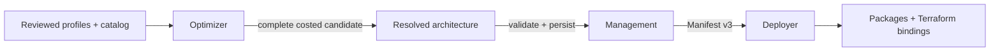

# Architecture Profile Contracts

Architecture profiles restrict optimization and deployment to reviewed
components and connections. A cheap candidate cannot compensate for a missing
required capability.

## Implementation and activation

| Boundary | Current state |
|---|---|
| Profile list/detail/select/preview APIs | implemented in Management |
| Immutable resolved architecture and projections | implemented |
| Optimizer resolution and Management admission | implemented; `ARCHITECTURE_PROFILE_RESOLUTION_ENABLED=false` by default |
| Manifest v3 and Deployer graph compilation | implemented and used for new deployment packages |
| AWS/Azure baseline profile definitions | `supported: true` in the catalog |
| GCP complete baseline | unsupported because L4/L5 implementations are absent |
| Flutter profile workflow / executable Eventing profile | later work |

The default-off resolver does not supply a new resolved architecture. New
deployment packages still require one; there is no implicit v2 fallback.
Enabling the resolver in both services is a controlled verification setting,
not a fix for the [known runtime/evidence gaps](../runtime/known-limitations.md).

## Four records

| Record | Owns |
|---|---|
| `ArchitectureProfile` | logical responsibilities, ports, edges, optimization slots and completeness rules |
| `ProviderImplementationProfile` | provider capability claims and mappings |
| `DeploymentComponentCatalog` | packages, runtimes, permissions, pricing references and Terraform bindings |
| `ResolvedTwinArchitecture` | immutable winning assignments, edges, costs, evidence and pinned references |

The resolved architecture references the exact calculation run and
`ResolvedDeploymentSpecification v1` digest. The specification remains the
source for SKU, capacity, memory, storage class, schedule and billing mode.
Neither object contains credentials, physical endpoints or user source code.

## Calculation and persistence

The public workload request cannot author profile or extension references.
When resolution is enabled, Management supplies the selected profile and active
bindings from owner-scoped persistence. Optimizer checks components,
capabilities, ports, edges, regions, pricing, deployment mappings and extensions
before ranking.

The same winning candidate produces the compatibility path, deployment
specification and resolved architecture. Management validates their cross-links
and persists them atomically. Failed architecture-aware calculations retain
bounded failure metadata; they never become legacy successes.

Migration `022_resolved_twin_architecture` reconstructs historical resolutions
only from complete, matching evidence. Other runs become
`legacy_not_resolvable` and are deselected. Component/edge tables and the seven
`cheapest_l*` fields are checked projections, not alternative sources of truth.

## Validation and limits

Draft 2020-12 schemas, canonical decimals and SHA-256 digests are shared across
the services. Local-only validation rejects unknown versions, duplicate or
unresolved IDs, forbidden cycles, incompatible bundles, incomplete evidence,
digest drift and secret-like fields with bounded `ARCH_*` errors.

The catalog maps all seven logical components and six baseline edges for
AWS/Azure. Its typed L4→L5 binding does not resolve the actual Grafana
datasource divergence. `processor.telemetry@1` has reviewed Python 3.11 adapter
mappings; this is a processing extension point, not an Eventing layer.

`ResolvedDeploymentSpecification v1` is baseline-only. A future Eventing
topology needs a new deployment-specification version and its own execution
evidence. See [Architecture Contract Development](../developer-guide/architecture-profile-contracts.md)
for schema/catalog changes.
