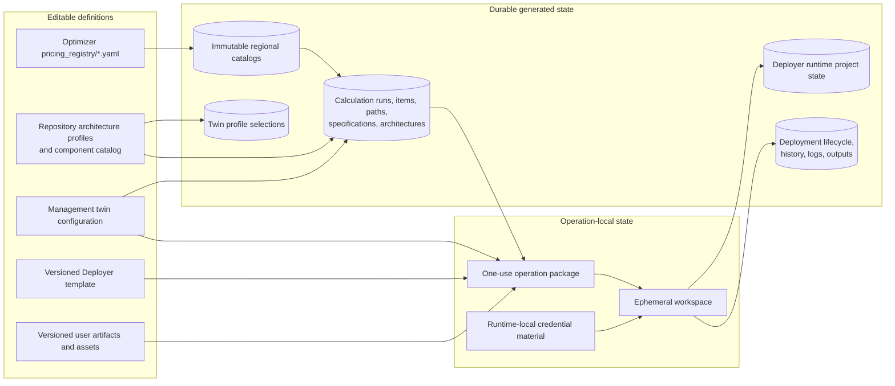
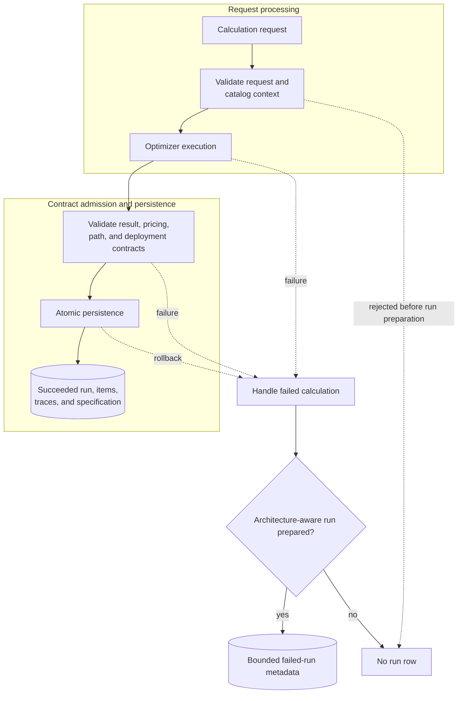
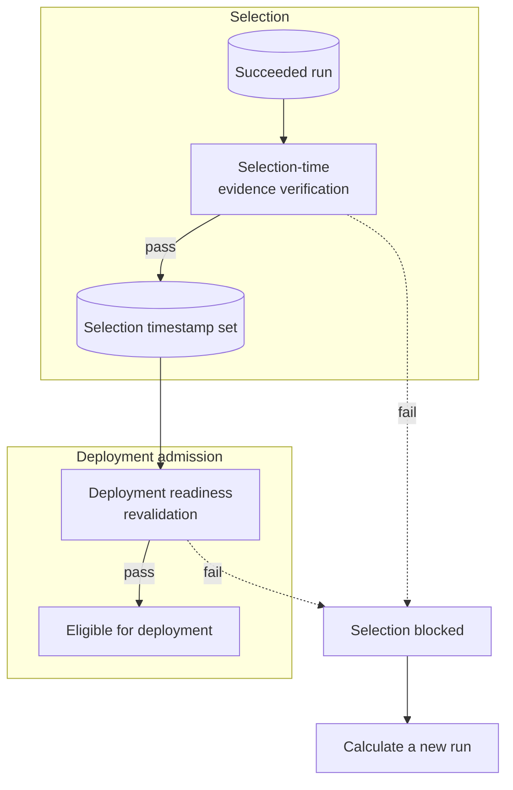
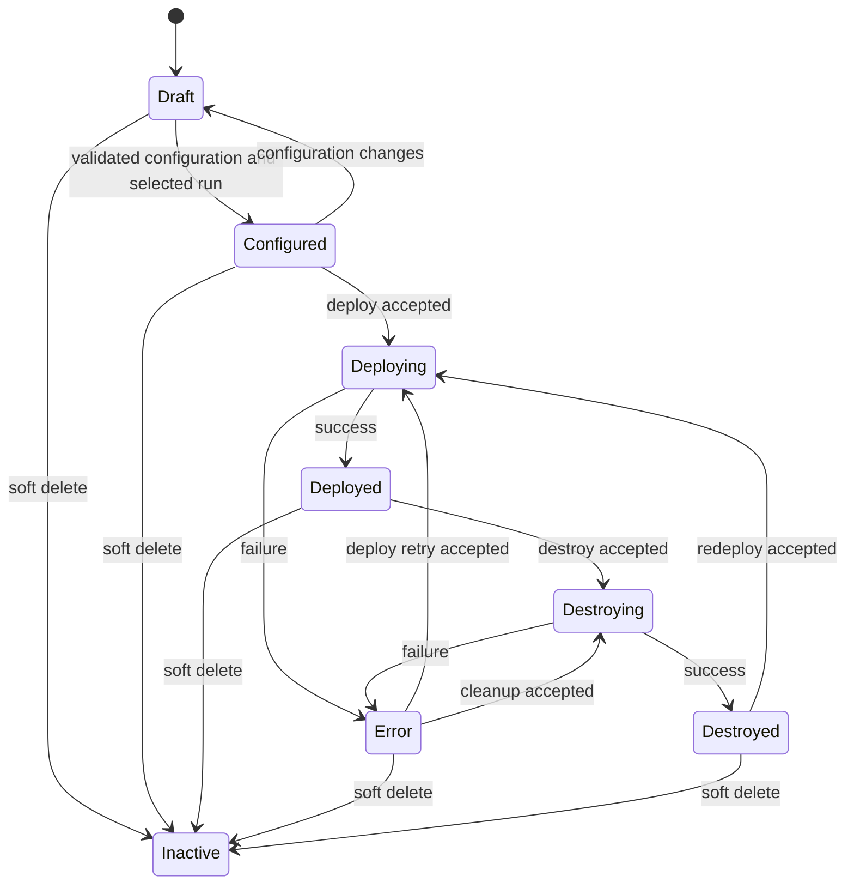

# State Ownership

## Systems Of Record

## Ownership Matrix

| State | System of record | Mutability | Main consumers |
|---|---|---|---|
| users, sessions, twins, lifecycle | Management database | transactional | Management API, Flutter |
| reusable cloud credentials | encrypted Management `cloud_connections` | owner-scoped transactional | credential resolver |
| wizard/configuration state | Management configuration tables and versions | transactional and lifecycle-invalidating | Flutter, run/deployment builders |
| pricing intents, mappings, formulas, models, routes | versioned Optimizer YAML registry | reviewed source change | refresh, calculation, validation |
| regional pricing catalogs | Optimizer immutable catalog store | append-only snapshots plus atomic active pointer | Management context resolution, calculation |
| pricing refresh/review history | Management database | append/update by workflow | Flutter pricing review |
| calculation results and specifications | Management database | immutable after successful run creation | Flutter, deployment selection |
| reviewed architecture definitions | repository `contracts/architecture-profiles/` | reviewed source change | all three backend validators |
| Twin architecture profile selection | Management database | owner-scoped, revisioned, invalidating | Management API; Flutter selection UI remains planned |
| resolved Twin architecture | Management database canonical JSON plus derived component/edge rows | immutable per calculation run | Management reads; Optimizer and Deployer when architecture resolution is enabled |
| operation package | Deployer package store | immutable, one acquisition | deploy/destroy operation |
| operation workspace | Deployer temporary storage | mutable only during one operation | Terraform and provider adapters |
| runtime project state and allowlisted outputs | Deployer runtime store | operation-controlled | destroy, status, verification |
| deployment history/logs | Management database | append/update by operation | Flutter REST/SSE |

## Calculation Run Lifecycle

### Atomic Run Creation

### Selection And Deployment Readiness

Successful runs persist atomically with `status=succeeded`. In the enabled
architecture-profile path, failures after run preparation persist bounded
metadata with `status=failed`, without a result or deployable architecture.
Earlier request rejection and the legacy calculation path do not create these
failed-run rows. Selection uses `selected_for_deployment_at`; staleness is
checked at selection and deployment readiness.

Historical successful runs remain inspectable. A run becomes deployable only when
its schema, catalog/account context, path evidence, and resolved specification remain
valid. Creating a newer run does not automatically select it; selecting another run
clears the previous run's selection timestamp.

Migration 022 additionally deselects every historical run that cannot be
reconstructed from complete matching architecture evidence. The Phase 8.4
fixture-gated admission boundary persists a failed run plus payload-free audit
evidence when architecture validation fails; it never commits a partial
resolution.

## Deployment State Transition

`TwinLifecycleService` owns lifecycle transitions. Routes, Flutter, Optimizer, and
Deployer may request or report actions but must not invent state transitions.

See [State And Persistence](../runtime/state-and-persistence.md).
