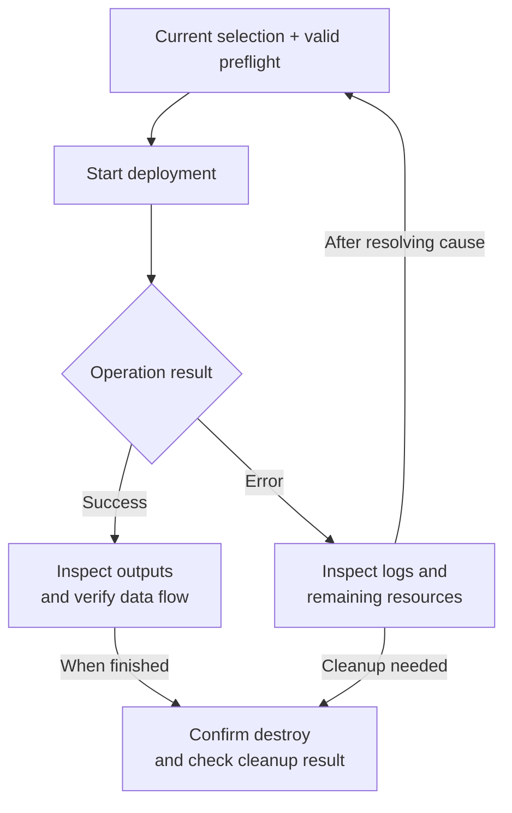

# Deployment And Verification

Deployment actions live on the twin overview after configuration. The UI uses the
Management API; it never uploads files directly to or starts operations on the Deployer.

New deployment packages require Manifest v3 and a resolved architecture. Profile
resolution defaults to off, and runtime/live verification gaps remain. Check
[Results and Limits](../runtime/known-limitations.md) before using cloud operations.

Deployment success and verified data flow are separate checks. An error can leave
resources behind; inspect the operation record before retry or cleanup.

## Before Deploy

Confirm:

- twin is `configured`, `destroyed`, or recoverable `error`;
- selected architecture is current;
- required deployment CloudConnections are present and validated;
- configuration/artifacts pass validation;
- deployment preflight is successful and not stale;
- a previous operation is not already active.

## During An Operation

The UI receives a session and SSE URL from the Management API. Progress is correlated
to persisted deployment history. Leaving the page does not make the operation disappear;
return to status/history instead of starting a duplicate.

## After Deploy

Inspect:

- final twin and operation status;
- structured Terraform outputs (with sensitive values redacted);
- provider/resource verification results;
- operation log history;
- data-flow verification phases where supported;
- simulator controls only after required provider material exists.

## Failure And Retry

An error preserves operation records and last error. Read the correlated log and
readiness/preflight state before retry. A failed deploy may still have created resources;
do not assume `error` means nothing exists. Destroy uses retained Terraform/runtime state
and explicit confirmation.

Mock deployment endpoints are development-only and require the test-route capability.
They exercise UI state/log handling without contacting providers, but they are not
live-cloud evidence.
