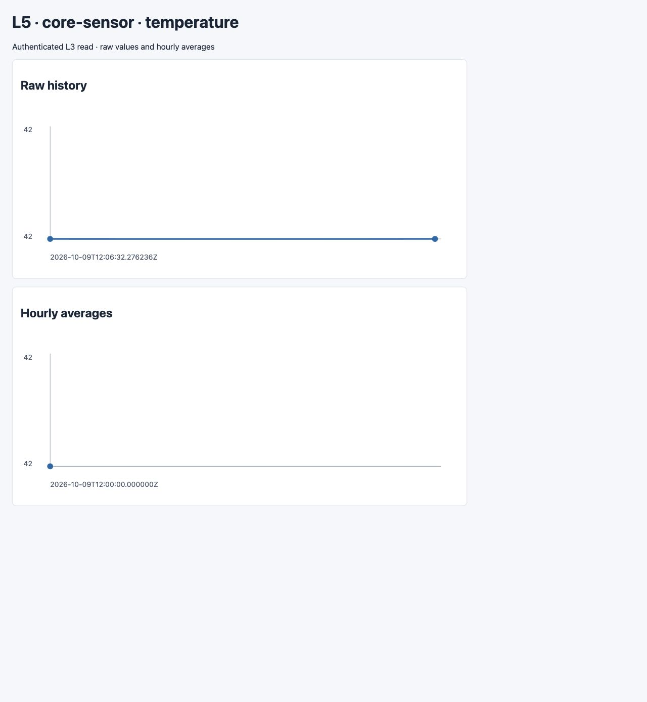

# Representative AWS application observation

Date: 2026-10-09. Runtime revision: `cd4e7b39` (documentation/model-only
checkpoint `16b51b23` was committed while the run was active).

**Functional result: passed.** This is one AWS-local Small application
observation, not nine complete-profile E2E passes. GCP L4/L5 remain excluded;
RQ1–RQ3 and the historical Five-layer reference are unchanged.

## Actual path and assertions

- The release Flutter UI started the ordinary Management → Deployer lifecycle
  using an explicitly selected supervised-evaluation candidate and real bound
  CloudConnection. The shared native root used the agreed auxiliary Azure
  authentication, but created no Azure or GCP resources.
- Reconnecting during deployment restored the same operation. Normal history
  contained exactly one Deploy for the successful new Twin before and after.
- The normal simulator download supplied the actual generated device identity
  and simulator source. No substitute publisher, direct command injection,
  seeded storage record or direct L4 write produced the successful sample.
- The first value `42` received a correlated command in **30.394552 s** and
  passed exact L3 raw/hourly readback. Its L4 assertion failed because the test
  payload omitted the existing explicit `projection_candidate` marker. That
  failed assertion and sample remain retained, not rewritten as a pass.
- A second uniquely traced value `42`, with `projection_candidate: true`, used
  the same deployed simulator path. Command receipt took **2.389944 s**. Exact
  raw timestamp/value, persisted hourly average, ACTIVE TwinMaker value/source
  sequence/observation timestamp and both L5 panel timestamps/values passed.
  The combined second verification took **9.381697 s**.
- The owner-authenticated Management L5 endpoint returned the real deployed
  consumer's HTML. The UI's L5 action also fetched it successfully (HTTP 200).
  The embedded browser did not expose the separate blob popup to automation;
  visual inspection therefore rendered an unchanged saved copy of that HTML.
  This proves the returned graphical content, not independently verified popup
  behavior in every browser or a provider SSO session. The UI's initial
  data-readiness badge is not retroactively treated as persisted verification.

Two raw points and one hourly average are visible because the unmarked first
sample also persisted. Both values are 42; the successful assertions additionally
check the second sample's exact timestamp and correlated L4 sequence. These two
command observations have different warm-up conditions and are not a latency
distribution or performance comparison.

## Lifecycle metrics and failed attempts

The successful normal deployment ran **270.536770 s** from the Management
operation's start to completion. Adjacent timestamped log boundaries yielded:

| Phase | Seconds |
|---|---:|
| Credential validation | 4.174642 |
| SDK initialization | 0.030555 |
| Packaging plus preplan | 1.002351 |
| Terraform initialization | 4.066141 |
| Image foundation | 62.844172 |
| Image publication | 42.637875 |
| Main Apply boundary | 147.500001 |
| SDK postapply | 7.295938 |

These are application-log boundary intervals, not instrumented provider API
service times. The normal deployment retains **110 resource creation completion
observations** and 3,315 log events. Resource addresses, reported durations and
timestamps are retained privately. The planned 111 managed entries include a
local timing resource and bindings, not 111 separately charged services; the
observation count is not forced to equal that planned count.

Five earlier Deploy attempts remain failed in the original Twin history:
source/runtime inventory, graph attachment, premature L5 foundation outputs,
TwinMaker IAM propagation, and reuse of a name reserved by an inactive IoT
command tombstone. Their operation times are respectively 0.030763, 0.956239,
73.110110, 218.144515 and 215.057355 s. They are not folded into the successful
sample or omitted from the cost-of-obtaining-evidence boundary. The final retry
used normal Duplicate/recalculation under a new namespace, not hidden Terraform
updates to a successfully deployed Twin.

## Cleanup and scope limits

The exact downloaded simulator certificate was matched against AWS and retained
in a private ownership journal. The existing bounded research cleanup removed
that SDK-owned certificate, its exact policy and Thing before normal Destroy;
this supplementary identity cleanup is part of the method, not a claim that
the ordinary SDK fallback catalog alone covers every identity.

The first normal Destroy took **157.246469 s** and failed its strict state gate;
it retained 104 destruction-completion observations. Provider fallback removed
the active resources but left stale Terraform entries. A second normal Destroy
reconciled the absent resources and succeeded in **30.976129 s**. Do not present
only the successful retry as total cleanup time. Independent inventories include
the exact simulator certificate and distinguish inactive IoT tombstones from
active resources. Final independent checks found zero active residuals in the
successful namespace (24 categories, including the exact certificate) and the
original namespace (23 categories), with one inactive IoT marker in each. The
old namespace retains a tombstone-related Terraform entry; it is not reported
as strict state-empty or marker-free cleanup.

One application run does not qualify Azure's complete normal workflow, directed
command return, cross-cloud L4, storage-tier transitions or all complete-profile
permutations. Existing isolated AWS/Azure L4/L5 results and nine Core passes keep
their original scope. No broad rerun was undertaken just to remove these limits.

## Billing checkpoint

Read-only month-to-date queries on 2026-10-09 reported **0.1635643374 USD** AWS
unblended account cost (provider-estimated) and **5.79732065454576 EUR** Azure
subscription ActualCost. Azure first returned HTTP 429; a later retry succeeded.
These are delayed account totals, not final run-attributed charges or a comparison
of provider prices. GCP's current total could not be reconciled in this check;
the console did not load a usable billing report. No older amount is substituted
as current.

## Renewed application checkpoint — 2026-10-20

The later AWS observation and its failed attempts are recorded in the
[current execution record](../../plans/2026-08-26_thesis_poc_execution_plan.md).
It independently exercised the real downloaded simulator and exact
command/L3/Event→L4/L5 path: deployment 292.615 s, correlated command 9.639 s,
combined functional verification 15.298 s, and 110 resource creation
completions. Existing UI actions reported infrastructure 12/12 and three
passed telemetry phases without skips. The unchanged returned L5 HTML was
rendered, but the separate browser popup still was not independently observed.

On October 20, ordinary Destroy reconciled the now-absent AWS IoT Command and
persisted an empty Terraform state. Its successful 32.293 s retry followed a
29.518 s authentication failure; both remain in the lifecycle history.
Independent inventory found zero in all 24 checked categories, including the
simulator identity and inactive commands. The actual UI reports `DESTROYED`
and complete cleanup. This closes the newer AWS application's cleanup finding;
it does not rewrite the older October 9 cleanup observations above or claim a
global account inventory.

Four renewed composed Azure attempts failed and were fully torn down, with
empty Terraform state and independent zero run-owned resources/role assignments.
The bounded fixes addressed principal selection, function-key response shape,
the actual IoT Hub/device identity and transient L5 readiness retries. The final
attempt still timed out at L5 after three bounded HTTP attempts. Registered
functions and a running host do not establish an operational graphical reader.
The narrow successful L5 fixture has one always-ready HTTP instance whereas
the ordinary deployment remains scale-to-zero. This difference is a hypothesis,
not a proven cause or an approved baseline change. Azure's composed simulator
and L4/L5 chain remains unqualified; separate Core and narrow-layer passes do
not fill that gap. No complete cross-provider UI E2E claim is made.

A fifth composed Azure attempt also failed L5 readiness with scale-to-zero
unchanged (932.330 s). Supplementary requests alternated between valid empty
HTML and generic HTTP 503/timeouts, including on unauthenticated requests.
Changing only the on-demand ceiling from one to two did not produce reliable
availability and was not adopted. Neither intermittent empty HTML nor a
registered/Running host qualifies the simulator/data/command chain. Added
transport-phase logging and L5 routing to the existing diagnostic workspace
improve diagnosis, not the functional outcome.

Its ordinary Destroy completed in 945.057 s; all 109 recorded creation and
109 deletion completions remain available as per-resource timing observations.
Terraform state is empty and independent resource-group/resource/scoped-role
counts are zero. The UI started deployment but the supplementary SSE consumer
owned completion; the stale browser required refresh. This boundary is retained
instead of reporting an uninterrupted UI E2E pass. The following minimal HTTP
host comparison is diagnostic-only; it cannot fill the composed Azure gap.

Three disposable HTTP-host diagnostics then separated application code from
hosting/client behavior. Each used a single West Europe Python 3.12 Flex
function, 2,048 MB, an on-demand ceiling of one and zero always-ready instances;
none deployed IoT, Cosmos, Digital Twins or application event handling.

| Diagnostic | Observation | Apply / Destroy |
|---|---|---|
| Minimal HTTP function with the existing extension-bundle configuration | First authenticated exact response: 1.013 s; next two requests timed out at 30 s; unauthenticated access returned 401. | 197.147 / 112.332 s |
| Same minimal function without the extension bundle | Apply succeeded, but the function-scoped key was not available within the bounded lookup. No HTTP or connection-reuse comparison ran. This does not establish a bundle-related root cause. | 255.880 / 112.110 s |
| Minimal function with the original bundle; independent clients | Docker `requests`: two exact responses (0.940 / 0.276 s). Host `curl --http1.1`: two 30 s timeouts. Docker `urllib`: one exact response (0.413 s), then a 30 s timeout. | 193.560 / 108.599 s |

The third runner's raw `passed` field refers only to its initial two `requests`
calls. A separate aggregate explicitly records that the **cross-client comparison
did not pass**; successful individual requests are not promoted to reliable
availability or application E2E evidence. All three diagnostics have eight
creation and eight deletion timing observations, empty Terraform state and
independent resource-group HTTP 404 after Destroy. Temporary access-key copies
were removed after the resources were deleted.

These observations argue against rewriting the thesis application on speculation
or blaming only Docker/one HTTP library. They do not distinguish an Azure
platform issue from all possible network-path effects, prove actual per-request
cold/warm state, or qualify the missing composed simulator/command/L4/L5 chain.
No production warm worker, scaling-ceiling change, package rewrite or longer
ordinary-read timeout was adopted. The subsequently approved regional comparison
is recorded below; the existing evaluation baseline remains unchanged.

### October 20 billing checkpoint

After the renewed Core deployments were destroyed, read-only month-to-date
queries returned **0.255320347 USD** AWS account UnblendedCost (estimated) and
**5.79715950530254 EUR** Azure subscription ActualCost/PreTaxCost. The GCP project
had no discoverable standard BigQuery billing export. Its associated billing
account was matched against Cloud Billing metadata, then checked in the existing
console session: the selected October 1–20 period displayed **0.81 EUR** cost,
**0.28 EUR** savings and **0.53 EUR** total cost. These GCP values are rounded
account-level display values, not project/run-attributed export rows or forecast.

All three amounts can lag actual usage and include other account activity.
They do not prove that this day's experiments are already fully billed, replace
an execution allowance ledger, or measure the incremental cost of any scenario.
Native currencies are retained without a synthetic combined total. Original API
responses and the separate GCP console observation remain private; no export,
new permission or billing configuration was enabled.

### North Europe host comparison — 2026-10-21

The separately approved diagnostic changed the region and unique resource names,
not the application baseline. The three package files were verified identical
in content to the West Europe client-comparison package. Python 3.12 Flex,
2,048 MB, maximum one on-demand instance, zero always-ready instances and the
existing extension bundle were retained. No Twin application was deployed.

| Client / check | First request | Second request |
|---|---|---|
| Docker `requests` | HTTP 200, exact body, 1.108 s | ReadTimeout, 30.264 s |
| Host `curl --http1.1` | Timeout, 30.014 s | HTTP 200, exact body, 0.454 s |
| Docker `urllib` | Timeout, 30.247 s | Timeout, 30.377 s |
| Negative authentication | HTTP 401, 0.510 s | Not repeated |

**Diagnostic result: failed.** The aggregate requires all six authenticated
responses to be HTTP 200 with the exact expected body, plus rejected anonymous
access. Successful individual requests do not satisfy that gate. No cloud
cold/warm state was measured. A single regional observation cannot establish a
platform root cause; the common network path remains an unexcluded factor.
North Europe is not a demonstrated fix and was not adopted as the new baseline.

Apply completed in **190.707 s** and ordinary Destroy in **113.998 s**. Eight
creation and eight deletion completion timings are retained privately alongside
source revision, package/plan hashes and per-request results. Terraform state
contains zero managed entries; an independent ARM lookup returned resource-group
HTTP 404. The temporary function-key copy was removed. No diagnostic resources
remain. These observations support RQ1's operational failure/cleanup record,
not a new RQ2 composed-functionality pass or an RQ3 cold-start/billed-cost claim.
The complete Azure UI/simulator/command/L4/L5 evaluation remains open.

### Long-timeout host diagnostic — 2026-10-22

The approved diagnostic retained West Europe Python 3.12 Flex, 2,048 MB,
maximum one on-demand instance and zero always-ready instances. The tiny
HTTP function added a per-request identifier in its log and response header.
Temporary workspace-backed Application Insights and FunctionAppLogs enabled
client/server correlation. These diagnostic resources were confined to the
run's resource group. Their instrumentation differs from the earlier minimal
fixtures, so this is not a controlled timeout-only performance comparison.

The ten-minute observation window started after package publication. Requests
were sequential at approximately 0, 90, 180, 300, 420 and 540 s, alternating
Docker `requests` and host-native HTTP/1.1 `curl`. Request timeouts were at most
180 s and capped by the remaining window (179 s for the fifth, 59 s for the
sixth). Each response required HTTP 200, the exact fixed body and the matching
identifier. Anonymous access separately had to return 401/403.

| Probe | Client | Observed client duration (s) | Correlated server request duration (ms) |
|---|---|---:|---:|
| 1 | Docker `requests` | 1.198 | 69.7833 |
| 2 | Host `curl` | 36.240 | 9.4059 |
| 3 | Docker `requests` | 10.562 | 7.2240 |
| 4 | Host `curl` | 0.814 | 4.9870 |
| 5 | Docker `requests` | 0.437 | 4.5664 |
| 6 | Host `curl` | 0.613 | 4.8520 |

**Minimal diagnostic result: passed, six of six**, with correlated successful
handler traces and server requests for all six on the same AppTraces role
instance. Anonymous access returned 401 in 5.358 s. The slow host-native request
completed DNS in 0.039 s, TCP by 0.131 s, TLS by 0.224 s and received its first
response byte at 35.786 s. The handler trace occurred approximately 36 s after
client start; this cross-clock interval is approximate, not a precise distributed
latency decomposition. The handler's server request lasted only 9.406 ms.

The direct finding is that a 30 s client cutoff can discard a valid response.
This sample locates the large observed delay before handler execution, but does
not identify the internal Azure routing/scheduling component. No worker-start
timeout, gRPC failure or application exception was found in the captured logs.
The early pre-publication empty-host warning does not establish a failing
published function. Historical HTTP 503 responses did not recur; their cause
remains unresolved. Neither measured per-request cold/warm state nor a blanket
claim that Flex normally requires five to ten minutes follows from this test.

The adopted change (`f84a043c`) allows 180 s per HTTP request only during
initial Azure L5 readiness. Its existing three attempts, rejected anonymous
access, exact HTML contract and size bound remain. Ordinary UI reads and AWS
keep 30 s requests. The focused access/API gate passes 29 tests, including
acceptance of a modeled valid response beyond the former cutoff and continued
failure on exhausted attempts/security errors. A full Azure application run
has not yet exercised this correction; the simulator/command/L4/L5 gap remains.

Apply took **203.120 s**. Terraform Destroy completed in **521.916 s**, retaining
eleven creation and eleven deletion completion timings. Its final resource-group
step waited on one additional Insights action group outside the eleven-entry
Terraform graph. Independent inventory resolved that sole remaining child in
the fresh diagnostic group; an exact scoped DELETE returned HTTP 200. The
already-running Terraform Destroy then completed. This supplementary cleanup
is explicitly part of the observed Destroy duration, not an unassisted Terraform
cleanup pass. Final managed state is zero and an independent ARM resource-group
lookup returns 404. Temporary function-key copies were removed. Source/package/
plan hashes, individual timings and correlated raw telemetry remain private.

### Composed Azure retry after the HTTP diagnostic — 2026-10-22

The sixth composed attempt ran revision `0a2676a4`, including the initial L5
timeout correction. A fresh bounded plan contained 111 create-only managed
entries and seven Function Apps with zero always-ready instances. Candidate
materialization and account preparation used normal Management API contracts;
the real Flutter UI validated the required contracts, completed distributed
validation and initiated deployment. This is not an entirely UI-only setup
or import qualification. An unnecessary empty legacy hierarchy entered during
test setup was rejected by distributed validation and removed before deployment;
the active profile requires no manually supplied hierarchy or scene.

**Application result: failed.** Terraform infrastructure applied, with 110
creation-completion observations. The deployment failed in SDK postapply after
**887.430 s**, before simulator verification. The last persisted boundary was
the start of SDK-owned operations approximately 239 s earlier; no individual
SDK phase was captured. Neither a specific L5 timeout nor a Management idle
timeout is established. The Management deployment stream has no read timeout.
The diagnostic HTTP-host pass therefore still does not qualify the composed
application path.

Ordinary Destroy succeeded in **988.226 s**, with 110 deletion-completion
observations and empty persisted state. Independent ARM inventories found zero
run-owned resource groups, resources and scoped role assignments. Both failed
deployment and successful teardown retain their timestamps and 220 resource
timing observations; failure is not overwritten by a later retry.

Commits `a8e242f6` and `6c7ca0ca` add secret-free SDK phase/duration diagnostics
and persist the failed phase, exception class and optional HTTP status through
the ordinary deployment stream. Exception text, credentials and URLs are not
exposed. These changes do not alter retries, timeouts or function semantics.
The focused runtime/lifecycle/access/API gate passes 120 tests. The diagnostic
instrumentation was not loaded in the sixth attempt; it is used by the next
separately recorded attempt. RQ1 gains the lifecycle failure/cleanup record;
RQ2 gains no new composed pass, and RQ3 gains no cold-start or billed-cost claim.

The seventh composed attempt ran revision `6c7ca0ca` through the normal UI
validation and deployment path. **Deployment and SDK readiness passed in
674.338 s**, with 110 creation-completion observations and zero always-ready
capacity. SDK phase durations, included in that total, were 9.629 s for L3
read access, 5.859 s for the Twin seed, 1.680 s for IoT registration and
69.212 s for visualization readiness. The ACR build succeeded after 0.421 s
queue time and 30.055 s build time; its immutable digest/context hash and
timestamps are retained privately. This is a deployment/readiness pass, not a
complete simulator/command/L3/L4/L5 pass or proof of per-request cold/warm state.

The external functional runner initially failed before its first cloud test
because its Docker Python path omitted the Deployer `src` directory. Its
failure handler had already started ordinary Destroy when an operator retried
the runner. Although the retry observed registered functions and the expected
control rule, its later command receipt deadline overlapped actual resource
deletion. **That functional observation is excluded**: the command timeout is
not evidence of an application failure, nor are its partial checks promoted to
a composed pass. Empty persisted cleanup logs before browser reconnection did
not mean that cloud deletion had not begun. The actual lifecycle state and
operation timestamps are authoritative. No lifecycle state was reset or success
record fabricated to recover this test.

The corrected research invocation uses `/repo` as Docker working directory and
`/repo:/repo/3-cloud-deployer:/repo/3-cloud-deployer/src` as `PYTHONPATH`.
Its dependency-only check passed without mounting credentials or making cloud
requests. The research launcher now checks for `deployed` before verification
and stops/excludes the verifier if the lifecycle changes during the test. These
are evaluation-start corrections, not new product features or relaxed data gates.
A fresh, non-overlapping functional observation is still required.

Ordinary Destroy succeeded in **981.157 s**, with 110 deletion-completion
observations and empty persisted Terraform state. Independent ARM resource-group,
resource and scoped-role inventories are all zero. The actual UI required a
reconnection to show the externally initiated Destroy; this is not labeled an
uninterrupted UI-only lifecycle. Deployment/teardown retain 220 resource timing
observations, and the invalid functional report is preserved with a separate
qualification record. Original credentials are unchanged; the temporary
auxiliary credential copy and local override have been removed. RQ1 receives
the successful deployment, test-steering failure and cleanup measurements; RQ2
still lacks the composed Azure data-path pass, and RQ3 receives no latency or
billed-cost conclusion from the excluded command test.

The safe Deployer collection passed 2,181 tests but initially skipped 63
template-package cases because the disposable test container lacked their
required `/app/upload/template` mount. Re-running exactly those 63 cases with
the read-only template mount passed 62 and retained one intentional legacy
skip. The combined, deduplicated gate is **2,243 passed, one skipped**, not a
single invocation with that summary. No E2E directory or cloud credentials were
supplied to these offline tests. The existing MQTT TLS deprecation and a
read-only pytest-cache warning are retained with the reports.

### Fresh bounded Azure application observation — 2026-10-22

The eighth attempt ran revision `3acbadfe`, following the corrected,
credential-free verifier dependency check. A fresh Azure-local Small candidate
and namespace passed normal UI contract/distributed validation and the reviewed
111-entry create-only plan (seven Functions, zero always-ready instances).
The UI started ordinary deployment. No source/identity change or warm worker
was introduced into this live attempt.

**Deployment result: failed in L5 readiness after 819.385 s.** All 110 resource
creation-completion observations were retained. SDK L3 read access, Twin seeding
and IoT registration passed in 9.771, 5.323 and 3.436 s respectively. The final
authenticated L5 HTML request raised `_L5NotReady`; that code path identifies
HTTP 502, 503 or 504, not a client read-timeout exception. Visualization readiness
took 191.887 s. The exact HTTP status and response body were not retained, so
the failure cannot be attributed conclusively to Azure hosting/routing.
The unchanged L5 handler also returns its own HTTP 503 if its L3/data read fails;
that internal HTTP read has a separate ten-second timeout. This is an unexcluded
alternative, not a demonstrated cause of the observed response. Initial host
warnings and unmatched/lagging host logs do not establish a published-function
failure or cold start.

The real simulator verifier correctly did not start because deployment never
reached `deployed`. There is no command, Event-to-L4, exact graphical-data or
full UI E2E pass for this attempt, and no test ran concurrently with Destroy.
The pre-reviewed simulator check used the existing Core command allowance of
300 s within its overall bounded verification window; that allowance was not
exercised. No timeout/retry rule was extended after this failure.

The ACR image build succeeded after 0.267 s queue time and 36.709 s build time;
immutable image/context identities remain private. Ordinary Destroy succeeded
in **1,009.468 s**, with 110 deletion-completion observations and empty Terraform
state. Independent resource-group, resource and scoped-role inventories are
all zero. Deployment/teardown retain 220 resource timing observations. The
temporary auxiliary credential copy and local environment override are removed;
original credentials and unrelated files are unchanged.

Later offline corrections retain exact transient HTTP status/request phase
(`811df59d`) and recognize only L5's fixed public error body, with other bodies
remaining unclassified (`b9940558`). The cloud handler logs exception class and
optional upstream HTTP code without URLs, keys, response bodies or exception
text. These diagnostics preserve existing responses, authentication/data gates,
three initial attempts and request timeouts; they are not a live fix claim.
Canonical package digests and generated copies were refreshed in `63bc9fe0`,
including demo fixtures, without changing architecture semantics. Existing
immutable experiment graphs were not rewritten.

The focused diagnostic/runtime/API gate passes 130 tests. The first full safe
gate retained one stale package-source-pin failure (2,253 passed, one failed,
one intentional skip); the canonical digest refresh corrected it without
weakening the package gate. The subsequent full safe Deployer suite passes
**2,254 tests with one intentional skip** and the existing no-network MQTT TLS
deprecation warning. Ten canonical-contract tests, twelve relevant Flutter
contract/demo tests, contract synchronization and the Flutter architecture
gate also pass. Raw failed and successful reports are retained separately.

RQ1 gains a correctly bounded failed deployment and successful cleanup;
RQ2 still lacks the composed Azure data-path observation. RQ3 gains neither
command latency nor cold-start/billed-cost attribution from this attempt.
The next diagnostic should isolate the existing L3-to-L5 path and classify the
503 origin before another complete Twin deployment; it requires a separately
reviewed live plan. No additional paid run was started here.

### Isolated zero-always-ready L3/L5 diagnosis — 2026-10-23

Runtime and saved-plan source: `c762f890`. The fixed research cut created only
the reviewed twenty managed entries: two Flex Apps/plans, serverless Cosmos,
private package storage, scoped data roles and packaging entries. Neither
always-ready workers nor IoT/Event/L4 resources or a processor image were added.
This is a seeded-data diagnostic, not a new composed application/UI attempt.

**The original L5 observation failed.** Nine completed authenticated requests
returned HTTP 503 with the fixed `L5 data unavailable` body. This identifies the
L5 application's data-read/render failure path, not a generic hosting error
page. The graphical and anonymous-access acceptance checks did not pass. The
exact exception inside that cloud handler was not captured. No
Application Insights resource was configured in this historical research cut;
available host diagnostics did not supply that exception. Configured and current
reader keys matched, and the live L5 URL matched the reader output.

The researcher closed this failing phase and paused its driver before direct
reader tests, avoiding redundant polling. The in-flight and subsequent L5
observations are excluded from the baseline. SIGINT/SIGCONT then routed the
driver directly into its guaranteed cleanup path; its raw `KeyboardInterrupt`
is an operator steering event, not the application's error. No verification ran
during Destroy and no lifecycle state was reset. The research runner now limits
Azure L5 polling to three attempts (`ec0ac7cf`), leaving room for reader follow-up
inside its existing deadline; that correction is offline-only in this record.

Direct raw readback passed with exact fixture data after **25.659 s**. The first
hourly read returned HTTP 503 after **60.370 s**, with its body unclassified;
a repeated production-range hourly query returned three points in **0.609 s**.
Direct Cosmos queries found three hourly records with integer counts and passed
the unchanged normalizer. These checks do not independently qualify the reader's
managed identity or establish a generic Azure platform root cause.

The **unchanged L5 code**, invoked from the host-side research client against
the actual reader, reproduced a concrete failure: raw HTTP 200 in **0.683 s**,
then hourly `TimeoutError` after **10.228 s**, producing L5 HTTP 503 after
**10.918 s**. This demonstrates the internal ten-second failure mechanism in a
separate client context; it is not a recovered trace of every cloud 503.
A separately qualified cloud-L5 read after the reader tests still returned
the fixed HTTP 503 in **13.104 s**. Reader pre-access is therefore not adopted
as a substitute for fixing the request policy.

A controlled host-client comparison allowed 60 s per reader attempt, at most
one transient retry, and a shared 150 s comparison deadline. It returned two
exact SVG panels in **72.167 s**: raw HTTP 200 after **10.456 s**, hourly timeout
after **61.271 s**, then hourly HTTP 200 after a retry in **0.433 s**. All six
values/timestamps matched the stored fixture. The HTML was rendered locally by
the production renderer; this is **not** a pass of the deployed cloud L5 handler
or the simulator/command/UI E2E. No cloud code was replaced during this test.

The subsequent narrow offline correction uses that bounded reader policy in
Azure L5. Only timeouts and HTTP 502/503/504 receive one retry; authentication,
other transport failures, invalid data and size limits remain fail-closed.
Remaining budget is checked before and after reads across both queries. Socket
timeouts do not themselves impose a hard DNS/end-to-end wall-clock limit; the
supervised run deadline remains separate. Azure's documented
[230-second HTTP response limit](https://learn.microsoft.com/en-us/azure/azure-functions/functions-bindings-http-webhook-trigger#limits)
is also distinct. No worker, capacity, dependency or architecture change is made.
Canonical source pins and generated copies are refreshed in `9c9cc74e` without
rewriting old experiment graphs. A fresh normal Azure application observation
is still needed.

Deployment took **443.136 s**. Ordinary Terraform Destroy completed in
**684.716 s**, retaining twenty creation and twenty deletion completion timings.
The total **2,226.096 s** includes researcher steering and diagnostic comparisons;
it is not application message latency or an uninterrupted E2E duration. Final
managed state is empty. Independent ARM checks found zero run resource groups,
resources and role assignments. The first supplemental role query included three
inherited ancestor-scope assignments; exact run-scope/descendant filtering
corrected that inventory classification. Both reports remain private and no
inherited role was changed or deleted. No diagnostic cloud resources remain.

The final safe Deployer gate passes **2,267 tests, one intentional skip** with
the existing MQTT TLS deprecation warning. The research runner/renderer/L4 gate
passes 73 tests; contract synchronization and thirteen contract tests pass.
Forty-two affected Flutter model/demo tests, its architecture gate and Ruff
also pass. Generated JSON changes are digest-only, with the architecture profile
unchanged. None of these offline checks promotes the failed cloud L5 baseline
to a live pass.

RQ1 gains a reproduced client failure and a bounded correction; RQ2's composed
Azure gap remains explicit. RQ3 receives no cold-start attribution or inferred
billed-cost result from these individual observations.
